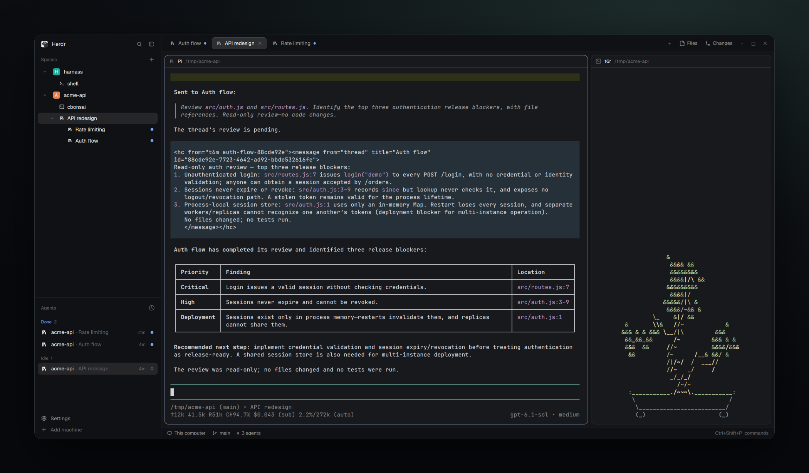

# herdr-project-spaces

A [herdr](https://herdr.dev) sidebar that shows [herdr-projects](https://github.com/ingur/herdr-projects) under each space: projects, their threads, sessions, agents and shells.



It is a copy of herdr's own Spaces panel. What it changes there:

- each space lists its projects, their threads, its sessions outside a project and its other agents and shells under it;
- a space row gets a fold arrow in front and, behind, the status of what a fold hides and, on hover, an archive button and a `+` for a new terminal;
- the filled row is the focused terminal's row, not the active space;
- dropping a stopped project or session on a space moves it there;
- a session with messages waiting shows their number;
- a space herdr closed stays listed, grey, while it holds unresolved sessions, and opens again with the ones that ran in it;
- a space that cannot be read keeps its projects under a dim row (a folder cell in the narrow rail).

## Install

Ask your agent in herdr:

```text
Read ~/.config/herdr-app/AGENTS.md, then add this mod: github.com/ingur/herdr-project-spaces
```

It copies the mod, points your Spaces panel at it and adds the keys. Your layout stays yours.

Without an agent:

```sh
git clone https://github.com/ingur/herdr-project-spaces
node herdr-project-spaces/install.mjs
```

## Use

| | |
| --- | --- |
| Click a row | open it; a closed space opens with the sessions that ran in it |
| `+` on a project | new thread |
| Right-click | rename, move folder, close, resolve, delete; on a closed space, remove it |
| Archive icon (on hover) | show or hide resolved ones |
| Drag | reorder; drag a stopped project or session onto another space to move it |

Keys (macOS uses `cmd` instead of `alt`):

| | |
| --- | --- |
| `alt-down` / `alt-up` | next / previous row |
| `alt-shift-left` / `alt-shift-right` | fold / unfold |
| `alt-shift-down` / `alt-shift-up` | move row |
| `alt-shift-r` | show or hide resolved |

## Update, remove

Ask your agent again, or:

```sh
git -C herdr-project-spaces pull && node herdr-project-spaces/install.mjs
```

To remove: point your Spaces panel back at `spaces` and delete `mods/herdr-project-spaces`.

## Good to know

- Based on herdr 0.1.16's Spaces panel. After a herdr update it may need a refresh; it tells you when the versions differ.
- Runs the command named by a terminal's `projects.control` label, on that terminal's machine.
- Cannot be combined with another mod that replaces Spaces.

## Develop

```sh
dev/try-herdr       # separate herdr window and settings
node --test tests/*.test.mjs
```
