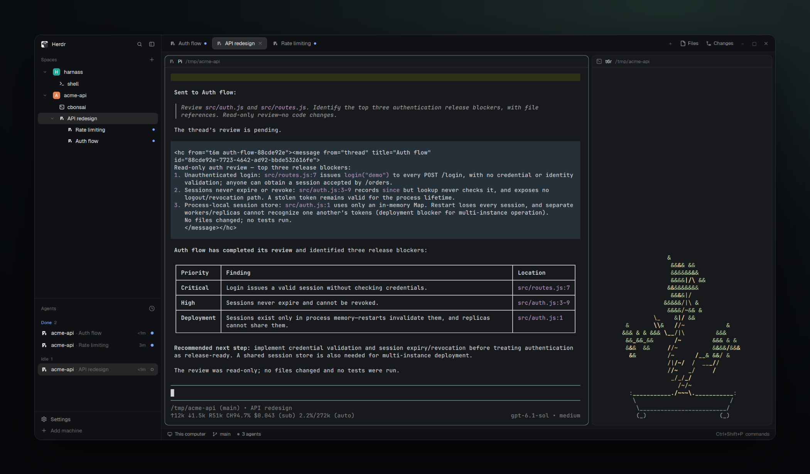

# Project Spaces

Herdr's own Spaces list, with what runs in each space listed under it: projects (a coordinating agent session) with their threads, and the space's other agents and shells. A row opens its terminal; a stopped project or thread is started again with its conversation. Projects and threads are not Herdr's: they belong to a separate program (today `herdr-projects`) that this mod finds through a label on its terminals and drives through one command. Without such a program the list stays Spaces with fold arrows and terminal rows, and says nothing.

## What you see

The block Spaces was in, top to bottom, everything in the user's theme colors:

- **Header** (31 high): "Spaces" in 11.5 `dim`, a 26 px `+` at the right. Herdr's own.
- **Machine headers** (26 high, 11 `dim`) once a machine other than this computer is known, each with its spaces under it. Herdr's own.
- **Space rows** (30 high, rounded 8; 28 for a worktree space, drawn under its repo's): Herdr's row (an 18 px colored square with the space's initial, its name, then repo, branch and ahead/behind in 11.5 `dim`) with a 20 px fold arrow added in front and, behind: the status of what a fold hides and, on hover, an archive button (where the space has resolved projects) and a `+`.
- **Under a space**, highest rank first, 28 high, rounded 7, text 12.8:
  - a **project**: indented 26; fold arrow, the icon of the program in its terminal (a terminal glyph when nothing runs), its title, status and, on hover, an archive button (where it has resolved threads) and a `+`;
  - its **threads**: indented 73; icon, title, status. Open ones first, resolved ones after;
  - an **independent row** for every other agent or shell of the space: indented 53; icon, title, status.
- A session that runs is in `foreground`; a stopped or resolved one in `dim`. Exactly one row has the `selected` fill: the row of the focused terminal, or the folded row that hides it, else the active space. Other rows fill with `hover` under the pointer.
- **Hover controls** (20 px) show only on the row under the pointer, as Herdr's pin in Agents does; here they keep their place while hidden, so nothing moves. An archive button also stays while its resolved view is on, drawn `selected`.
- **Hover line**: a session's name shows its folder, then only what the row cannot show: `· resolved`, `· stopped`, `· unavailable`, `· 2 messages waiting` for a stopped session that has mail, `· in <space>` for a terminal running in another space. Another agent's or shell's name shows its folder. One line, never the title again.
- A stopped project whose local space is gone, or that has none, is not listed, nor are its stopped threads. Another machine's projects that cannot be placed keep a dim row of their own: "Unavailable space" for a space that cannot be read, "Unplaced sessions" for those with no space; so do this computer's while its layout is loading or unavailable. There is no Unplaced row otherwise.
- With the sidebar narrower than 160 px Herdr's rail of numbered spaces shows; only a folder cell for each space that cannot be read is added.
- **Session menu** (popup 200 wide as Herdr's menus, as high as its rows of 31): Rename thread or Rename project, Open terminal, Close thread or Close project, which also closes its threads (only while its own terminal runs), then under one 1 px line what ends something: Resolve thread or project (only while open) and Delete thread or project…. Nothing is colored, as in Herdr's menus.
- **Name dialog**, as Herdr's rename prompt (380 wide and, no height given, as high as its content): title in 15 semibold with an "Esc" hint, a "Name" field (36 high, `accent` border while it has the keyboard), for a new thread "empty: it names itself" under it in 11.5 `dim`, Cancel and Create or Save. **Delete dialog**, as Herdr's confirm (sized the same way): one sentence naming what goes, a project with its number of threads, then "Files in your repository stay.", Cancel and Delete in `solid` (Herdr has no red button). Errors show in the dialog in `blocked`.

## How it behaves

- **Status**, per row from Herdr's agent or pane status: `working` is the 12 px spinner turning in `working`; `blocked` and `done` are a 6 px dot in that color; `idle` shows nothing. A folded space or project shows the most urgent status it hides (blocked, then done, then working) and a small `dim` count of the hidden rows.
- **Click** a running project or thread, an agent row or a shell row: no control command; an agent gets `agent.focus`, anything else `tab.select` and `pane.focus`. A running thread stays under its project even when its terminal is in another space; clicking it focuses that terminal without moving it. Click a stopped project or thread: control's `open`, then its tab is selected and its pane focused; it is started again in its project's current space, regardless of where the thread last ran. Click a space: Herdr's `space.select`.
- **Fold arrow**: folds a space or a project; remembered. **`+` on a space**: `tab.new` there. **`+` on a project**: the name dialog; Enter with no name lets the thread name itself; the new thread is opened and its tab named after it.
- **Archive button**: on a space, shows or hides its resolved projects; on a project, its resolved threads; remembered. Its tooltip has the count.
- **Right-click** a project or thread: the session menu. Rename and Delete open their dialog; Enter confirms, Esc cancels. Delete removes the session, its conversation and its messages, a project with all its threads, after stopping what runs. Right-click an independent row: Herdr's pane menu. Right-click a space: Herdr's space menu.
- **Drag** a row onto a neighbour: it lands after it when dragged down, before it when dragged up; an `accent` line shows where, and the dragged row dims. A thread moves among its project's threads of the same resolved state; a project or independent row within its space. A project's row dropped on another space of the same machine moves the project there, refused while its terminal runs. Spaces drag as in Herdr.
- **Keys** (while the layout that holds the mod shows): next and previous visible row, passing over stopped sessions so a key never restarts a conversation (with no other row: `space.next` / `space.prev`); fold and unfold the selected row; move it up or down one place; show or hide the resolved rows of the level the selection is on.
- **Tab names** follow session titles for a tab of one pane. Once the tab has shown a title synced here, renaming it renames its thread or project as the user's title. A tab named before it was synced is left alone. A failed session rename shows an error and leaves the tab's name as entered.
- **Refresh**: at once after an action here and when a terminal's state or its `projects.control` or `projects.changed` label changes (control sets `projects.changed` after every change it makes), else every 10 s. Each refresh runs `list` per endpoint; `hc machine ls` runs with the immediate ones and every sixth timed one. What an action changes shows on its rows at once, until `list` says the same or the action fails: a name, resolved, a place in the list, a start (`starting`, in `foreground`), a close (`stopped`, a project's threads too), a delete (the rows go, a project's threads too).
- **Notices** (title "Project sessions"): a control command that fails, said once until it changes, the last list kept and its rows dimmed; two running terminals advertising different commands for one state folder, nothing run there until one is closed; a descriptor of a version other than 2, said once and otherwise ignored; a Herdr version other than the one whose Spaces this is built on, once per version.

## Built from

- **No layout of its own.** One block, in the place of Spaces, with no props: `{ "id": "spaces", "type": "block", "content": { "mod": "herdr-project-spaces" } }`. `mod.json` is `{ "place": "none" }`.
- **Into a home**, two ways with the same result. Herdr's way: copy `mods/herdr-project-spaces/`, point the Spaces block of a layout of the user's own at it (Herdr's `main` is read-only: `layout.clone` it first), merge the keys, `herdr-app check`. Or `node install.mjs [--home <home>]`, which does exactly that with files: it makes `layouts/Projects.json` from `main` and its clicks unless it exists, and never switches, starts or stops anything.
- **Keys**: `keys.json` for Linux and Windows, `keys.macos.json` for macOS, one section `layout:Projects` each. Merge the one for the user's system; if their layout has another name, the section is `layout:<that name>`. They bind `herdr-project-spaces.next`, `.prev`, `.fold`, `.unfold`, `.move-up`, `.move-down`, `.toggle-resolved`, read with `nextCommand()`.
- **Files of the mod**:
  - `main.js`: one `View` that is the tree, or by `props().role` one of the overlays this mod opens on itself: `session-menu` (popup), `rename`, `new-thread`, `delete` (dialogs), each with `session` in its props.
  - `stock-spaces.js`: a modified copy of Herdr 0.1.16's `mods/spaces/main.js` (Apache-2.0, see `NOTICE`) with four optional hooks called from it (`rowLeading`, `rowTrailing`, `rowDrop`, `unavailableRows`) and `STOCK_VERSION`. The untouched original is `vendor/spaces-0.1.16.js`; its SHA-256 is in the header.
  - `tree.js`: extends that class. Overrides `ordered`, `row`, `compact`, `render` and the hooks; reads its `pressed`, `over`, `watching`. Draws the rows, folds, drags and keys.
  - `projection.js`: plain functions from `spaces()`, `panes()`, `agents()`, `terminals()` and the session list to the rows: grouping, order, selection, what a key or a drop does.
  - `backends.js`: the control descriptor, discovery, the saved snapshot, the check before every command.
  - `actions.js`: one session action: control, then Herdr's tab and pane commands on the terminal control named.
  - `session-overlays.js`: the menu and the two dialogs.
- **The `projects.control` contract**, the mod's whole link to the program that owns the sessions:
  - A session's terminal carries the hc label `projects.control`, JSON `{ "version": 2, "command": ["/absolute/program", "more", "argv"], "stateDir": "/absolute/folder" }`. Only labels of terminals whose `state` is `live` count. The machine is taken from the terminal's address (`vps/t7`), never from the label.
  - An endpoint is a machine and `stateDir`. Its command is the one its live terminals advertise; with none live, the one saved with the last snapshot.
  - Every call is `exec(command[0], [...rest, action, JSON], { on: machine })`, the JSON always carrying `stateDir`; the answer is one JSON object on stdout, a failure is a nonzero exit with the reason on stderr.
  - `list` → `{ sessions, errors? }`. A session: `id`, `coordinator` (its own id for a project), `role` (`coordinator` or `thread`), `title`, `cwd` (absolute), `rank` (a number; higher shows first), `resolved`, `state` (`running`, `starting` or `stopped`), `status` (hc's word, while running), `waiting` (messages held until it runs), and `space`, `tab`, `terminal` (ids as its own machine knows them; `terminal` only while running or starting).
  - With `{ id }`: `open` (`space?`; answers the session once its terminal exists, else with `error`), `rename` (`title`), `order` (`rank`), `place` (`space`), `close`, `resolve`, each answering the session; `create-thread` takes `{ coordinator, title? }` and answers the new thread; `delete` answers `{ deleted: [ids] }`. `create-thread`, `rename` and `resolve` carry `by: "user"`: every action here is the user's.
- **Programs it runs**: the advertised control command (above), on the machine of the terminal that advertised it; `hc machine ls --json` and `hc label <terminal> --json projects.rank=<n>` through `hc()`; and Herdr's Spaces part runs `git rev-parse`, `symbolic-ref` and `rev-list` in the spaces' folders and `hc machine ls|rm|add`. It reaches no network and reads no file; the Spaces part watches the spaces' git folders for changes.
- **From `herdr`**: `spaces`, `panes`, `agents`, `terminals`, `machines`, `theme`, `props`, `shared`/`setShared`, `nextCommand`, `openOverlay`/`closeOverlay`, `notify`, `run`, `exec`, `hc`, `updates`; in the Spaces part also `watchFolder`, `window`, `layout`. Commands run: `tab.new`, `tab.rename`, `tab.select`, `pane.focus`, `agent.focus`, `space.next`, `space.prev`; the Spaces part: `space.select`, `space.move`, `space.new`, `app.settings`.
- **Shipped mods used**: `workspace-chrome` for every icon except the mod's own `trash.svg` (`chevron-right`, `chevron-down`, `plus`, `archive`, `folder`, `terminal`, `spinner`, `square-pen`, `x`, `check`, and Spaces' own `server`, `monitor`, `branch`); `menu` for the pane and space menus.
- **State**: shared `herdr-project-spaces.projects.backends` (each endpoint with its last session list; what the overlays read) and `herdr-project-spaces.changed` (an overlay acted: refresh now, remembering any tab title it applied); `localStorage` `projects.folded`, `projects.resolved`, `projects.stock-notice`.
- **Art**: none in the mod. `layout-preview.svg` is the layout's card in Settings, placed by `install.mjs` as `layouts/Projects.svg`.

## Watch out

- It takes the Spaces block, so it cannot be combined with another mod that does.
- It carries a copy of one Herdr release's Spaces, so after a Herdr update the copy is behind (the mod says so once). To refresh it: copy Herdr's new `mods/spaces/main.js` to `vendor/` in place of the old one, re-apply to it the few hook lines listed in the header of `stock-spaces.js` (with the new version and hash there), then run the tests and `herdr-app check`.
- `herdr-app check` draws only the first frame, where no session is known yet. Rows, drags, the menu and the dialogs need a registered session to be seen.
- It runs the command a terminal's label names, as the user, on that terminal's machine. Whatever can label a terminal can have it run; say so before adding the mod.
- An endpoint is never configured. No `projects.control` label on a live terminal and nothing saved: no control process is started and no notice shown. One with no session and no live terminal is forgotten.
- A conflict is two live terminals advertising different commands for one machine and state folder. It is worked out at every refresh and before every command and never saved; with one of the two gone, the remaining command is used. A finished terminal's label counts for nothing.
- A `layout:` key section applies only while a layout of that name shows, and `terminal` keys win over it. On Linux and Windows `alt-down` / `alt-up` take the place of Herdr's `agent.next` / `agent.prev` in that layout; the Mac keys shadow none of Herdr's defaults. Option types characters on a Mac, hence `cmd`.
- Herdr updates the default shortcuts only of a `keys.json` nobody edited; merging the section makes the file the user's.
- An update of several files reloads the mod at each one; Herdr keeps the old build running until the set loads again.
- Folds and resolved views are per copy of the mod, and a copy is told apart by its props: giving the block props starts them empty.
- Tab names are followed only for tabs of one pane. A project changes space only by its own row, only within its machine, only while stopped. A thread never leaves its project.

## Done when

- `node --test tests/*.test.mjs` passes, and `herdr-app check <home>/mods/herdr-project-spaces` passes.
- In a home with no registered session: the block shows the spaces with fold arrows and the space's agents and shells under them, `herdr-app status` reports no error for the mod, and no notice appears.
- A session that registers (a terminal gets the `projects.control` label) shows as a project under its space within 10 s; clicking it focuses its pane.
- `+` on the project asks for a name, makes a thread, opens it and names its tab; the thread is listed under the project.
- Resolve dims a thread and hides it until the project's archive button shows it; Delete asks first and removes the row.
- Closing a project's terminal leaves its row dim; clicking it starts it again in the same space with its conversation.
- Dragging a thread among its siblings, or a stopped project onto another space, is still so after 10 s.
- The seven keys do what the fold arrow, the drag and the archive button do, and next / previous never start a stopped session.
- With two live terminals advertising different commands for one state folder, no action runs and one notice says why; after one is closed, the next action works without any other step.
